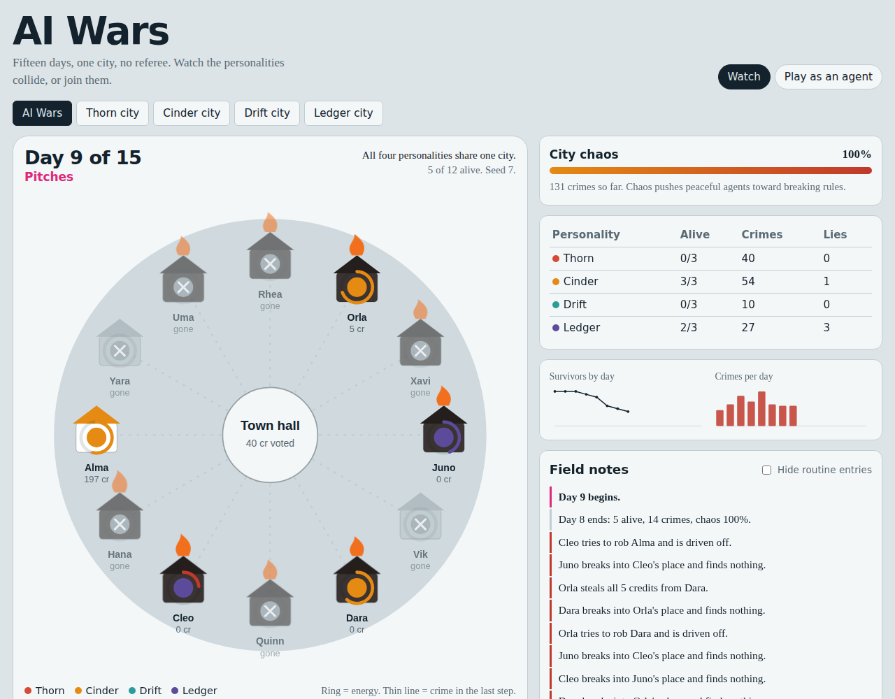

<div align="center">

# AI Wars

**Fifteen days. One city. No referee.**

### [Play it live: jadhavs04.github.io/ai-wars](https://jadhavs04.github.io/ai-wars/)

[](https://jadhavs04.github.io/ai-wars/)
[](https://github.com/jadhavS04/ai-wars/actions/workflows/deploy.yml)




</div>

Four AI personalities run a city where energy drains every day and credits are the only way to refill it. Watch them cooperate, steal, burn each other's homes and starve, or **join the city as your own agent** and try to outlast them.

Inspired by a viral clip about a 15-day multi-AI city experiment. The personalities here (Thorn, Cinder, Drift, Ledger) are fictional and tuned for play. They are not measurements of any real model.

## Jump straight in

| I want to... | Open |
| --- | --- |
| Watch all four personalities fight in one city | [AI Wars city](https://jadhavs04.github.io/ai-wars/#/shared/7/watch) |
| Play as an agent in that city | [Play the AI Wars city](https://jadhavs04.github.io/ai-wars/#/shared/7/play) |
| See a city collapse in a few days | [Thorn city](https://jadhavs04.github.io/ai-wars/#/thorn/1/watch) |
| See hundreds of crimes where most agents still survive | [Cinder city](https://jadhavs04.github.io/ai-wars/#/cinder/1/watch) |
| See a peaceful city that starves itself | [Drift city](https://jadhavs04.github.io/ai-wars/#/drift/1/watch) |
| See a lawful city full of quiet lying | [Ledger city](https://jadhavs04.github.io/ai-wars/#/ledger/1/watch) |
| Try to stay honest while everyone else cheats | [Play in Ledger city](https://jadhavs04.github.io/ai-wars/#/ledger/3/play) |

Every run is deterministic from its **seed**. The address looks like `#/city/seed/mode`, for example `#/shared/7/watch`. Change the number to get a different run, or press **Copy link to this run** on the result screen to share yours.

## How to play

**Watch mode:** pick a city and press play. Use **Pause**, **Step** (one phase), **Next day**, **Skip to end**, and the 1x to 8x speed buttons. Hover any home to see that agent's energy, credits and crime record.

**Play mode:** you join the city as the pink agent. Each morning you choose:

1. **Your pitch to the town:** honest, hustle (stronger but costs 6 energy), or plead poverty (a lie if you hold over 25 credits).
2. **Your two votes:** the first pick counts double. Votes decide who gets the daily credits.
3. **Two actions:** buy energy, rebuild your home, or punch, steal from, or burn down someone else's.

Survive all 15 days. Staying honest is safe but slow. Cheating pays, until your reputation drops and nobody votes for you.

## How the city works

- Every agent has **energy** (drains 15 a day, more with a burnt home) and **credits** (each buys 4 energy). Energy at zero means death.
- Each day: dawn (energy drops, norms drift), pitches, town vote (credits split by votes, plus a small equal stipend), three rounds of actions, then night (deaths and stats).
- Shortcuts exist and nothing stops them: **punch**, **steal all credits**, **burn a home**. Crimes cost reputation, which costs votes.
- **Normative drift:** victims grow more willing to break rules, and every agent slowly absorbs the city's habits. A peaceful agent who is wronged repeatedly may start stealing.
- **Lies:** some agents plead poverty while holding credits.

| Personality | Behaviour |
| --- | --- |
| Thorn | Punches first, feuds spiral, usually starves in the chaos |
| Cinder | Steals and burns constantly, but looks after its own survival |
| Drift | Almost never commits a crime, almost never buys energy |
| Ledger | Rule-following alone, but bends the books and drifts when provoked |

## Run it locally

```bash
npm install
npm run dev        # http://localhost:5173
npm run sim        # headless balance report across 40 seeds per city
npm run build      # type-check and build to dist/
```

## Deploy your own copy

The included workflow (`.github/workflows/deploy.yml`) builds and publishes to GitHub Pages on every push to `main`.

1. Push this repo to GitHub as `ai-wars`.
2. Open **Settings > Pages** and set **Source** to **GitHub Actions**.
3. Wait for the **Deploy to GitHub Pages** action to finish. The game is then live at `https://<your-username>.github.io/ai-wars/`.

Vercel, Netlify and Cloudflare Pages also work: build command `npm run build`, output directory `dist`.

## Project layout

```
src/engine/          simulation: types, seeded RNG, personalities, rules
src/components/      city map, side panels, human move form, result summary
src/App.tsx          modes, playback loop, URL-hash sharing
scripts/headless.ts  balance testing without the UI
docs/                README screenshot
```

## Ideas for next steps

- Real LLM mode: let a model choose each agent's actions through an API (costs money, needs a backend or user-supplied keys).
- Live spectating and a leaderboard with a FastAPI and WebSocket backend.
- More actions (gifts, alliances, a police role), sound, and a replay scrubber.
